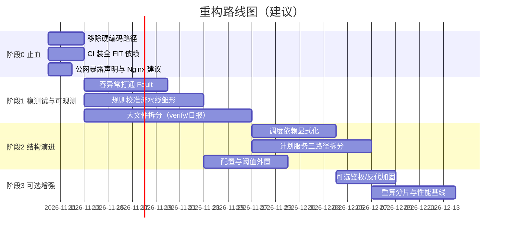
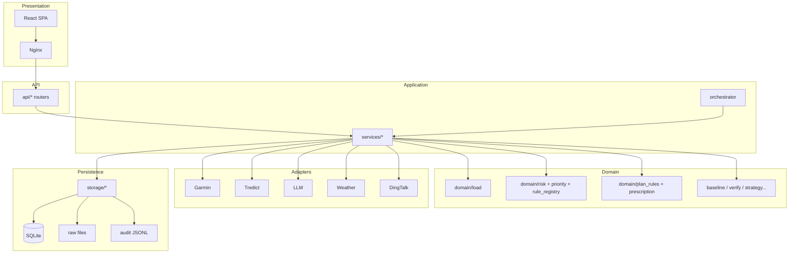
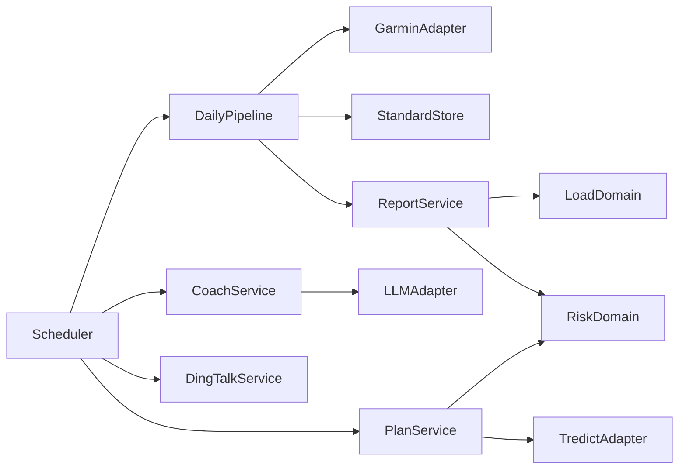
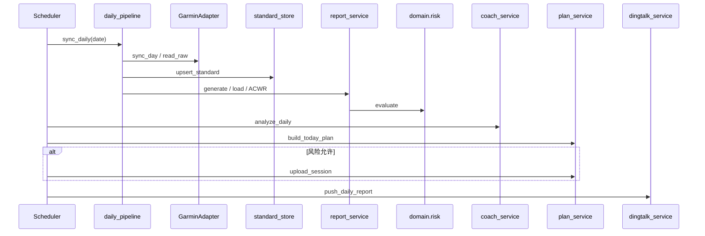

# 架构诊断与改进建议（ARCHITECTURE_REVIEW）

> 基于对仓库全部源码与配置的只读分析（2026-11-07）。  
> **证据原则**：每个问题均附具体文件路径与关键符号；无法从代码确认的结论明确标注「基于推断/未能确认」。

---


## 执行进度（截至 2026-11-09，v3.4.7）

| 编号             | 项                                                              | 状态                 |
| -------------- | -------------------------------------------------------------- | ------------------ |
| A.2.1 / C.4.1  | `api/ops.py` 移除开发机硬编码路径                                        | ✅ v3.1.0           |
| A.9.1          | CI 前置 quality 门禁（ruff + pytest）                                | ✅ v3.1.0           |
| A.4.2 / C.4.5  | 下游步骤失败结构化写入 Fault 表                                            | ✅ v3.1.0           |
| A.6.1          | 公网暴露风险声明（README §5.5）                                          | ✅ v3.1.0           |
| A.3.2          | FIT 双依赖测试稳定性                                                   | ✅ 已确认非缺陷；CI 必装全量依赖 |
| A.2.2 / C.4.5  | 调度依赖显式化 + 消除 services→orchestrator 层级倒置                        | ✅ v3.2.0           |
| A.1.2 部分       | `daily_report.py` 拆分（725→625，负荷/ACWR 抽出）                       | ✅ v3.2.0           |
| A.1.2 部分       | `plan_service.py` 拆分（733→约 430，上传/12周/上下文抽出）                   | ✅ v3.2.0           |
| A.1.1 / A.10.1 | 分层约束与体量预算自动化（`test_architecture_layering.py`）                  | ✅ v3.2.0           |
| A.1.2 / C.4.2  | `domain/verify.py` 拆分为 `verify/` 包（1016 行 → 9 模块，最大 298 行）     | ✅ v3.3.0           |
| A.8.1          | 结构化日志：单点配置 + `task_id`/`date` 上下文注入 + 命名规范                     | ✅ v3.3.0           |
| A.5.2          | 规则阈值校准：双规则集对照回放（`domain/calibration.py`）                       | ✅ v3.3.0 首版        |
| A.5.2 剩余       | 校准结果接入「候选阈值外置为数据文件」                                            | ✅ v3.4.0           |
| A.8.1 剩余       | 采集端（Nginx access log / 前端）统一 request_id                        | ✅ v3.4.0           |
| A.1.2 前端       | `DailyPage.tsx` 729 → 440 行（展示区块外提 + 结论规则入 lib）                | ✅ v3.3.1           |
| A.9            | `gen:api` 改为后端离线导出 OpenAPI（不依赖后端进程）                            | ✅ v3.3.1           |
| A.1.2 前端       | `WeeklyPlanPage.tsx` 757 → 413 行（展示区块外提，同 DailyPage 做法）        | ✅ v3.3.2           |
| A.9 剩余         | `types.ts` 迁移到 `schema.d.ts`（构建时生成、不入库；CI 先 `gen:api` 再 `tsc`） | ✅ v3.4.2           |
| 部署回归           | nginx `log_format` 写在 `server` 内 → 容器起不来；已加构建期 `nginx -t`      | ✅ v3.4.1           |
| 构建链根治          | `package-lock.json` 重生成（全平台 optional 条目）→ CI 恢复纯 `npm ci`      | ✅ v3.4.3           |
| 死资产清理          | 旧前后端独立镜像 Dockerfile / nginx.conf / `.dockerignore` 全删          | ✅ v3.4.3           |
| A.9 收尾（训练）    | 训练详情契约纳入 OpenAPI：`response_model` + `training.ts` 派生             | ✅ v3.4.4           |
| 数据可观测性         | FIT 明细缺失显式 `hr_data_state` 三态 + NAS 部署前自检                     | ✅ v3.4.4           |
| 数据自愈（训练）      | 容器自足补齐 `fit_jsonl`：23:30 job + 上传时就地补 gz + 失败告警/ledger（部署即触发 v3.4.8 移除） | ✅ v3.4.5           |
| 力量明细回归         | 三层：生成 notes 前就地补 gz + 不误导兜底 + 受控清单回填历史错误 notes          | ✅ v3.4.6           |
| 日任务容错（日报）     | `hr_zone` 脏值不再让日报静默缺失：上游格式 + 下游归一化 + 生成步 Fault 兜底       | ✅ v3.4.7           |

**前端修复（v3.2.0，非本文档原有条目）**：

| 项         | 问题                                                    | 状态           |
| --------- | ----------------------------------------------------- | ------------ |
| ACWR 窗口截断 | `DailyPage` 只取 21 天，而后端按 D−56 预热 → 历史日报 ACWR 不一致      | ✅ 改为 56 天同口径 |
| 类型漂移      | `DailyReport` 缺 `strategy` / `algo_versions` 两个后端已有字段 | ✅ 已补齐        |
| 缓存策略缺失    | 报告类 query 无 `staleTime`，切页必全量重请求                      | ✅ 统一 60s     |

**v3.3.0 落地细节**：

- **A.1.2 verify 拆分**：`verify/` 包按既有分节切为 `states` / `core` / `fingerprint` /  
  `result` / `channels` / `online` / `fields` / `raw` / `summary` 九个模块。  
  `__init__.py` 门面原样 re-export 旧单文件全部 **46 个公开符号**，  
  5 个测试文件 + 2 个脚本零改动。`__all__` 是必需的（否则 ruff F401 会删 re-export）。  
  `test_verify_package_facade.py` 以清单式断言锁定这 46 个符号。  
  体量预算白名单已清空，`domain/` 一并纳入预算检查。
- **A.8.1 结构化日志**：新建 `app/logging_conf.py`（唯一 `basicConfig` 位置、`Settings.log_level`  
  真正生效、`log_context` 上下文管理器 + `ContextFilter`）。日志格式 `[task_id@date]`，  
  五个调度任务（daily / sleep_retry / weekly / monthly / tredict_sync）在入口包一层  
  `log_context`。logger 命名统一为 `hs.<子系统>.<模块>`，两层 AST 断言防止回退。  
  **踩坑记录**：`try: with log_context(...): ... except:` 时 `__exit__` 先跑、contextvar  
  已被 reset，在 `except` 里打的日志会丢 `task_id`——日志必须留在上下文块内。  
  **连带修掉的存量 bug**：`alembic` 的 `env.py` 调 `fileConfig()` 用了默认  
  `disable_existing_loggers=True`，会把进程内既有 logger 全置 `disabled`；迁移与应用  
  同进程跑时（测试、启动引导）此后 `hs.*` 日志静默消失。已显式传 `False` 并加契约测试。
- **A.5.2 校准首版**：`strategy_replay` 是自一致性检验，回答不了「换阈值会怎样」；  
  且阈值是 import 时烧死在 `rule_registry` 模块常量里的，`RULES` 是全局单例。  
  为此给 `judge_priority` 加了可选 `specs` 参数（默认 `None` = 当前规则，行为不变），  
  `domain/calibration.py` 用「当前规则集 vs 候选规则集」跑同一批历史数据，  
  输出逐日差异与优先级迁移矩阵。CLI：`python -m app.domain.calibration_cli --set P1-LOAD-HRV.acwr_high=1.45`。**只读**，不写库、不改全局规则、不产生策略版本。

**v3.3.1 落地细节（第二批 · 前端）**：

- **DailyPage 拆分**：按「有没有状态」切，展示区块外提到  
  `components/reports/daily/`（Headline / Appendix / TrainingTable / Skeleton + format），  
  结论规则 `buildHeadline` 抽到 `lib/headline.ts`（纯函数）。  
  页面只留数据编排与交互状态，729 → 440 行，最大子模块 110 行。行为零变化。
- **`gen:api` 修复**：原脚本直接打 `http://localhost:8000/openapi.json`，必须先起后端，  
  且失败只有 ECONNREFUSED。改为后端 `scripts/export_openapi.py` 离线导出  
  （`app.openapi()`，不连库，54 路径），前端 `scripts/gen-api.mjs` 串起导出→生成→清理，  
  并自动定位 `backend/.venv` 解释器。生成物按 `.gitignore` 忽略。
- **清理**：`frontend/src.bak-20261022/`（198K，无引用）、27 个  
  `vite.config.ts.timestamp-*.mjs`（vite 异常退出残留）——均未入库，仅本地磁盘。
- **未做**：`WeeklyPlanPage.tsx`（757 行）单独立项，本轮不动。

**v3.3.2 落地细节（第二批 · 前端，续）**：

- **WeeklyPlanPage 拆分**：判据与 DailyPage 一致——「有没有状态」。页面只留数据编排与  
  交互状态（react-query hooks、mutation、拖动排序、日期切换、modal 开关），展示区块外提到  
  `components/plan/weekly/`：`format`(50) / `WeekHeader`(57) / `DayCard`(141) /  
  `SessionPrescription`(72) / `EvaluationPanel`(111) / `PlanActionBar`(69)。  
  757 → 413 行，最大子模块 141 行。子组件一律 props 进、回调出，不自己发请求。
- **行为零变化的验证方式**：提取拆分前后的中文字符串字面量集合做**双向 diff**。  
  原文件有而新代码缺失 4 条、新代码多出 19 条，逐条确认**全在注释里**，无用户可见文本变化。  
  辅以 `tsc --noEmit` 与 `build` 通过（`WeeklyPlanPage` 分包 15.79 kB / gzip 5.90 kB）。
- **顺带修掉每次 render 重建**：`SessionPrescription` 的 `stepText` 提到组件外；  
  `PlanActionBar` 的状态文案抽成 `statusText()`（原先三元嵌套在 JSX 里）。
- **`schema.d.ts` 策略已定**：**构建时生成、不入库**（已写入 `.gitignore`）。  
  `types.ts` 的迁移延后——迁移后 CI 必须先跑 `gen:api` 再做类型检查，否则类型文件不存在。

**v3.4.0 落地细节（可观测性与配置收尾）**：

- **A.8.1 采集端 request_id**：三段打通，链路 `浏览器 → Nginx → 后端日志`。
  - Nginx：`map $http_x_request_id $hs_request_id { default $http_x_request_id; "" $request_id; }`  
    ——前端带了就透传，没带用内置 `$request_id` 生成，**进后端之前**的请求  
    （404、超时、静态资源）也有 ID。access log 换自定义格式带 `rid=`。
  - 后端：`app/middleware/request_id.py`，**纯 ASGI 中间件**。刻意不用  
    `BaseHTTPMiddleware`——后者把下游放独立 task，contextvar 传播与同一条协程链  
    不同，日志里拿不到 request_id 是最常见的症状。
  - 非法入站值**丢弃重新生成**，不清洗（洗白后可能与上游撞车）。字符集  
    `[A-Za-z0-9._:-]{1,128}`：这个值要进日志（CRLF 注入）与响应头（控制字符会让  
    uvicorn 报错）。下游若也写了同名头，去重成**一个**且以中间件为准。
  - access log 只打 `status>=400` 或 `>=500ms`：Nginx 已记全量，后端再记一遍是  
    双份噪音，NAS 上 `docker logs` 长得很快。
  - 前端 `ApiError` 新增 `requestId`，上报障时给这一个字符串即可对上日志。  
    **踩坑**：`crypto.randomUUID` 只在安全上下文（https/localhost）可用，NAS 内网  
    走 `http://192.168.2.2` 是**非安全上下文**，那里它是 `undefined`——必须降级到  
    `getRandomValues`。
- **A.5.2 候选阈值外置**：`data/rule_thresholds.json`（或 `RULE_THRESHOLDS_FILE`）  
  可覆盖 `thresholds`，校准结论得以固化，不再需要改源码提交。
  - **文件不存在 = 用默认值**（常态，不能因缺文件就挂）；**非法 = 抛错**，  
    静默忽略会让人以为「调了但没效果」。
  - 只覆盖 `thresholds`，不碰 `condition` / `reason`——否则变成「配置文件里藏逻辑」。
  - **`RULES` 保持不变**（它是「代码默认值」+ 校准基线）；生效规则走  
    `effective_rules()`，判定链路入口 `ordered_specs()` 已改读它。
  - `calibrate` 的 baseline 缺省取生效值——运维眼里的「当前」是已上线覆盖值；  
    要对照代码默认值需显式传 `baseline=rr.RULES`。
  - CLI 新增 `--file`，与运行时同一套校验；`rule_thresholds.example.json` 有测试  
    锁住「样例必须能通过校验」，避免照抄 example 在上线时炸。

**v3.4.1 事故与修复（v3.4.0 致命回归）**：

v3.4.0 上线即不可用：容器内 `nginx FATAL Exited too quickly`，  
`[emerg] "log_format" directive is not allowed here in /etc/nginx/conf.d/hs.conf:22`。

- **根因**：为 access log 加 `rid=` 字段时，把 `log_format` 写进了 `server {}` 内。  
  `log_format` 只允许出现在 `http` 上下文；`conf.d/*.conf` 被 include 后，  
  一旦进入 `server {` 就是 server 上下文。
- **为什么全绿却起不来**：CI 的 `build-and-push` 只**构建**镜像、从不**加载**配置；  
  `npm run build`、`ruff`、`pytest` 都碰不到 nginx。**配置语法从未被执行过**。
- **修法**：`map` / `log_format` 移到 `deploy/nginx.http.single.conf`，  
  由 server 文件首行 `include /etc/nginx/hs-http.conf;` 引入；  
  Dockerfile 增加 COPY 并在构建期跑 `nginx -t`。  
  `nginx -t` **只看输出里的 `[emerg]` / `[error]`，不看退出码**——Debian 的  
  `nginx.conf` 带 `user www-data;`，在非 root 或缺该用户的环境里会因无关原因  
  返回非零，看退出码会把无害的环境差异变成构建失败。
- **回归测试**（`test_deploy_config.py` 新增 6 条）：断言 http 级指令不在 `server {}` 内、  
  `$hs_request_id` 的 map 定义存在、server 文件 include 片段、Dockerfile COPY 到该路径并跑校验；  
  并有**反向自检**——用 v3.4.0 的原样错误配置喂给检测器，必须报出来。  
  没有反向自检时，「块里没有 log_format」可能只是解析器什么都没识别到（假绿）。

> 明确不做的：**ECharts 体积优化**。已按需注册（`components/ui/echarts.ts`），  
> 633 kB 基本无冗余，删组件只省 10-15 kB，收益不足以承担回归风险。

> 状态说明：✅ = 已落地并有测试锁定；⬜ = 仍在待办。

---

## 目录

- [A. 问题诊断 + 改进方向 + 优先级](#a-问题诊断--改进方向--优先级)
- [B. 分阶段重构路线图 + 风险与收益评估](#b-分阶段重构路线图--风险与收益评估)
- [C. 模块/文件级重构方案](#c-模块文件级重构方案)

---

## A. 问题诊断 + 改进方向 + 优先级

### A.1 分层与模块边界

#### A.1.1 总体分层清晰，执行较一致（正向）

**现象**：`AGENTS.md` 与目录结构明确区分：

- `api/`：薄路由
- `domain/`：纯计算、无 IO
- `services/`：编排
- `adapters/`：外部边界
- `storage/`：持久化

**证据**：

- `backend/app/main.py`：仅注册 router 与全局异常处理。
- `backend/app/domain/risk.py`、`domain/priority.py`、`domain/load/*`：无 Session、无 httpx。
- `backend/app/services/daily_pipeline.py`：显式编排 adapter + storage + domain。

**影响**：可测试性强（domain 可单测），边界清晰利于演进。

**改进方向**：保持；在 code review 中把「domain 禁止 IO」写进 CI 规则（例如 import-linter 或简单 AST 检查）。

**优先级**：P2（巩固优势）。

---

#### A.1.2 服务层与报告层文件体量偏大

**现象**：部分核心文件 LOC 较高，职责仍可再拆。

**证据**（`wc -l`）：

| 文件                                              | 约行数  |
| ----------------------------------------------- | ---- |
| `backend/app/domain/verify.py`                  | 1016 |
| `backend/app/domain/rule_registry.py`           | 510  |
| `backend/app/services/reports/daily_report.py`  | 725  |
| `backend/app/services/plan_service.py`          | 733  |
| `backend/app/services/tredict_sync_service.py`  | 688  |
| `backend/app/services/reports/period_report.py` | 436  |

**影响**：单文件认知负担高；并行修改冲突概率上升；新人上手曲线变长。

**改进方向**：

- `verify.py`：按「通道/校验类型」拆为子模块（`verify/channels/` + 门面）。
- `daily_report.py`：将「数据装配」「章节渲染」「风险段落」拆成私有函数模块或子包。
- `plan_service.py`：分离「周计划构建」「今日计划」「上传」三路径。

**优先级**：P1。

---

### A.2 耦合与依赖

#### A.2.1 健康检查中残留开发机硬编码路径 ✅ 已修复（v3.1.0）

**现象**：`ops` 健康检查对 Garmin / Tredict 的「是否已配置」判断中，硬编码了 Windows 与特定盘符路径。

**证据**：`backend/app/api/ops.py` 中：

```python
plugin_session = Path(
    os.path.expanduser(
        "~/AppData/Local/dsh-plugin-garmin-connect/accounts/personal-cn.session.json"
    )
)
...
tredict_cfg = Path(r"F:/WorkBuddy AI/Garmin_Tredict/_tools/tredict.config.json")
```

**影响**：

- 在 Linux/NAS 容器中这些路径永远不存在，判断逻辑依赖「或」分支才正确。
- 泄露开发机目录结构，不利于开源或协作。
- 新环境误判「已配置」的风险（若未来有人挂载类似路径）。

**改进方向**：删除硬编码路径；统一以 `Settings` 中的 `garmin_tokenstore`、`tredict_token`（及 `tredict_ready`）为唯一真相源。插件引导若仍需要，改为可选配置项。

**实际落地**：插件 session 分支与 `F:` 盘配置探测**整体删除**（不保留永远为 None 的配置项）。  
Garmin 只判 `tokenstore/tokens.json` 或 `garmin_email`；Tredict 只判 `settings.tredict_ready`。  
`HealthResponse` 形状不变。锁定测试：`tests/test_ops.py::test_health_source_has_no_hardcoded_dev_paths`  
（源码级断言，防止路径再次混入）+ 3 条判定分支测试。

**优先级**：P0（正确性与可移植性）。

---

#### A.2.2 调度器与服务之间的延迟导入

**现象**：`orchestrator/scheduler.py` 大量使用函数内 `from app.services... import ...`，以避免循环依赖。

**证据**：`_sync_daily`、`_run_downstream` 等内部延迟导入。

**影响**：运行时才暴露导入错误；类型检查与静态分析较弱；新人不易看出真实依赖图。

**改进方向**：引入薄「应用层门面」或把调度任务注册改为「可注入的 callable 表」，使依赖在模块顶层可见；或接受现状但在 ARCHITECTURE 中维护依赖图。

**优先级**：P2。

---

### A.3 可测试性

#### A.3.1 测试覆盖面优秀（正向）

**现象**：`backend/tests/` 下大量针对 domain、load、risk、pipeline、API 的用例；`conftest.py` 将数据目录重定向到临时目录，避免污染仓库。

**证据**：本环境执行结果约 **991 passed**（排除因缺失 `fitdecode` 的用例后）。

**影响**：重构安全感高。

**改进方向**：将 `fitdecode` / `garmin-fit-sdk` 纳入 CI 必装依赖；为缺失可选依赖的测试使用 `pytest.importorskip`。

**优先级**：P1。

---

#### A.3.2 FIT 解析双依赖导致测试脆弱 ✅ 已确认非缺陷

**现象**：`app/parsers/fit.py` 顶层 `import fitdecode`；`test_fit_parser.py` 与 `test_verify_engine.py` 的指纹测试依赖解析器代码存在。

**证据**：

- `backend/app/parsers/fit.py:36`：`import fitdecode`
- 测试失败信息：`ModuleNotFoundError: No module named 'fitdecode'` 导致 3 个 verify 相关失败。

**影响**：干净环境或网络受限时 CI 不稳定。

**复核结论（2026-11-07）**：在本机完整依赖环境下 `test_fit_parser.py + test_verify_engine.py`  
合跑 **65 passed**。`fitdecode` 与 `garmin-fit-sdk` 均在 `pyproject.toml` 硬依赖中  
（`dependencies` 而非 `optional-dependencies`），因此「干净环境失败」实为**评审环境依赖未装全**，  
不是仓库缺陷。不需要做降级策略或 `importorskip`——那会把真正的依赖缺失变成静默跳过。

**改进方向**：CI 已按 A.9.1 安装全量依赖（`pip install -e "./backend[dev]"`），FIT 用例在 CI 中真实执行。

**优先级**：P1 → 已关闭。

---

### A.4 错误处理

#### A.4.1 统一 AppError + 全局处理器（正向）

**证据**：`backend/app/errors.py` + `main.py` 的 `@app.exception_handler(AppError)`，响应体 `{error: {code, message, detail}}`。

**影响**：前端可稳定解析错误码。

**改进方向**：确保所有外部 adapter 异常均映射为 `AppError`，避免裸 `Exception` 泄漏 500 且无码。

**优先级**：P2。

---

#### A.4.2 日流水线「吞异常记步骤」模式 ✅ 已修复（v3.1.0）

**现象**：`scheduler._run_downstream` 对 analysis / plan / dingtalk 使用宽泛 `except Exception`，只写入 `out["steps"]`。

**证据**：`backend/app/orchestrator/scheduler.py` 中多处 `except Exception as e`。

**影响**：优点是单步失败不阻断后续日期；缺点是根因可能只留在日志/步骤字符串，告警不够结构化。

**改进方向**：保留「不阻断」语义，但统一写入 `Fault` / 任务状态机，并产生可查询的 fault 记录（系统已有 fault 相关表与 API，应打通）。

**实际落地**：新增 `_record_step_fault()`，四个步骤（analysis / plan / dingtalk / upload）失败时  
调用既有 `recovery_service.report_fault()` 登记，`kind=generalTech`（一般技术故障，不需人工确认）、  
`impact_scope=f"{step}@{date}"`、`fix_measures=f"{异常类型}: {消息}"`。  
登记本身失败只记 warning，**绝不阻断日任务**。  
`out["steps"]` 字符串格式保持不变（向后兼容既有消费方）。  
锁定测试：`tests/test_scheduler_downstream_faults.py`（8 条，含「Fault 表写失败不影响流水线」与「全成功时零记录」）。

**优先级**：P1 → 已关闭。

---

### A.5 配置管理

#### A.5.1 pydantic-settings + SecretStr（正向）

**证据**：`backend/app/config.py`：`SecretStr`、`ensure_dirs`、`llm_ready` / `tredict_ready` 统一判定。

**改进方向**：将仍散落在代码中的「候选阈值」逐步迁入 Settings 或规则注册表，避免魔法数。

**优先级**：P2。

---

#### A.5.2 风险阈值「候选值待验证」

**现象**：配置与规则中多处注释标明阈值为候选、待校准。

**证据**：`.env.example` 与 `config.py` 注释（如 `validate_min_replay_match`、风险规则版本说明）；`rule_registry.py` 内阈值字典。

**影响**：生产行为依赖个人经验值；复现实验时版本字段能追溯，但科学校准流程未产品化。

**改进方向**：建立「规则版本 + 校准数据集 + 回放」流水线（系统已有 strategy_replay / verify 能力，可复用）。

**优先级**：P1。

---

### A.6 安全性

#### A.6.1 单用户无认证（设计选择）✅ 已补声明（v3.1.0）

**现象**：无登录、CORS `allow_origins=["*"]`（`main.py`）。

**证据**：`AGENTS.md` 明确「单用户、无登录」；`main.py` CORS 配置。

**影响**：在内网/NAS 场景可接受；若暴露公网则风险极高（健康数据 + 可触发同步/写操作）。

**实际落地**：README §5.5 增加醒目的「禁止将 18080 直接暴露到公网」警示块，说明后果  
（健康数据可读 + 同步/上传/故障恢复等写操作可被调用）与内网/VPN + 反代鉴权要求。  
未引入应用层认证——那是与既有设计选择冲突的方案。

**优先级**：P0（若公网暴露）；否则 P2。当前已通过文档声明处置。

---

#### A.6.2 密钥与数据

**正向**：密钥用 SecretStr；secrets 目录只读挂载；原始数据不入库。

**残留风险**：开发机路径硬编码（见 A.2.1）；`.env` 误提交需靠 `.gitignore`（已有）。

**优先级**：与 A.2.1 绑定。

---

### A.7 性能

#### A.7.1 单 worker + 串行任务（与 NAS 约束匹配）

**证据**：`docker-compose.single.yml` 注释说明群晖 cgroup 限制，仅设 `mem_limit: 1024m`；uvicorn 单 worker + 调度串行。

**影响**：对个人日频任务足够；高峰批处理（大量历史重算）可能变慢。

**改进方向**：重算路径提供 CLI（已有 `recompute_cli`）并支持按日期分片；避免在请求路径做重计算。

**优先级**：P2。

---

### A.8 可观测性

#### A.8.1 审计 JSONL + 任务状态 + 健康检查（正向）

**证据**：`storage/audit_store.py`、`orchestrator/task_state.py`、`api/ops.py` 的 health / tasks / faults。

**改进方向**：

- 统一结构化日志字段（request_id / job_id / date）。
- 关键失败自动写入 Fault 表并在前端运维台高亮（部分已有，需打通吞异常路径）。

**优先级**：P1。

---

### A.9 构建与发布

#### A.9.1 单容器 + 强制 HS_TAG（正向）✅ 已补 CI 门禁（v3.1.0）

**证据**：`docker-compose.single.yml` 使用 `${HS_TAG:?...}`；`.github/workflows/build-and-push.yml`；`deploy/nas_deploy_single.sh`。

**影响**：可追溯、可回滚。

**改进方向**：在 CI 中跑完整 pytest（含 FIT 依赖）与前端 `npm run build`，作为镜像构建前置。

**实际落地**：workflow 新增 `quality` job（`ruff check` + `python -m pytest tests/ -q`

- 前端 `gen:api` / `tsc` / `vite build`），`build-and-push` 声明 `needs: quality`，  
  镜像构建**只消费** quality job 产出的 `frontend/dist` artifact。  
  锁定测试：`tests/test_deploy_config.py`（`TestCiQualityGate` 7 条 + `TestLockPlatformCoverage`  
  3 条 + `TestNoLegacyFrontendImage` 4 条 + `TestBuildArtifactHygiene` 2 条）：  
  job 存在与依赖关系、Dockerfile 不含 npm 指令、`gen:api` 早于 `tsc`、  
  dist artifact 双向传递、lock 全平台条目与纯 `npm ci`、旧镜像资产不得复活、  
  构建中间产物不得入库。

**优先级**：P1 → 已关闭。

#### A.9.2 前端类型由后端契约派生 ✅ v3.4.2

**证据**：`frontend/src/api/types.ts`、`frontend/scripts/gen-api.mjs`、`frontend/src/api/schema.d.ts`（不入库）。

**问题**：`types.ts` 曾手工维护 40+ interface。逐字段比对后发现两类漂移：

1. **漏字段**（不会报错，只会让 `obj.field` 变成类型错误 → 开发者加 `as any` 绕过）：  
   `MonthlyReport.algo_versions` / `.strategy` / `.strategy_changes`、`WeeklyPlan.strategy`、  
   `WeeklyReport.algo_versions`。
2. **错字段**（类型说「有」，运行时拿到 `undefined`）：  
   `EnvironmentDaily`（字段全错，真实契约是 `EnvironmentResponse`）、  
   `LoadSeriesDay`（`load/acute/chronic/ratio` vs 真实 `total/by_sport/acwr/acwr_state`）、  
   `SeriesResponse`（`{days}` vs 真实 `{metric, points}`）。

**实际落地**：

- `types.ts` 465 → 124 行，改为 `components['schemas']['X']` 派生；仅保留生成器表达不了的少量手写类型  
  （`TaskStatus` / `StrategyChange` / `FieldDiff` / `StrategyLink`）。
- 后端补齐 5 处「内联成裸 `dict`」的契约（`LoadSeriesResponse` / `LoadSeriesDay` / `HrParamsView` /  
  `Plan12WeekItem` / `WeekPlanCard`），并把 `WeeklyPlan.evaluation` 从 `dict` 改成 `PlanEvaluation`。  
  收紧后立刻暴露两个真 bug：`plan_service._plan_payload` 把 `PlanEvaluation` 对象直接塞进 JSON 列  
  （`TypeError: not JSON serializable`）、`Plan12Week.weeks` 前端一直读到 `unknown`。
- CI 顺序固定为 `npm ci → gen:api → tsc → vite build → 上传 dist artifact`；  
  `build-and-push` job 下载该 artifact 后只做 `COPY frontend/dist`，  
  `Dockerfile.single` 里**不再有任何 npm 指令**。

**关于 CI 构建的三次失败（v3.4.2 落地过程中的主要成本）**：

| 尝试 | 做法                                              | 结果                                     |
| -- | ----------------------------------------------- | -------------------------------------- |
| 1  | Dockerfile 里 `npm ci` + `npm run build`（Alpine） | 失败，只有 `exit code 1`                    |
| 2  | 改 `npm install`（以为缺 musl 原生模块）                  | 仍失败                                    |
| 3  | 前端构建移出 Dockerfile，交给 ubuntu runner              | 仍失败，但**定位到** `vite build` 失败而 `tsc` 通过 |

**根因**：`package-lock.json` 的 `packages` 里**没有任何平台原生包条目**——  
连 win32 的都没有。`optionalDependencies` 声明里全平台都有（esbuild 23 个、  
rollup 27 个），但生成 lock 时没把条目写进 `packages`。`npm ci` 严格照 lock  
安装，于是任何平台都装不到原生二进制，`vite` 启动即  
`Cannot find module @rollup/rollup-linux-x64-gnu`。

> v3.4.2 当时判断为「Windows 只记录当前平台」，实测更准确的说法是「一个都没  
> 解析」。本地能跑只是因为 `node_modules` 是历史 `npm install` 残留，并非 lock 有效  
> ——本地 `npm ci` 同样会失败。

**v3.4.2 的临时补丁（已拆除）**：`npm ci` 后补装两个平台包并钉死版本，  
由 `test_linux_native_pkgs_pinned_to_lock_versions` 锁版本一致。补丁能跑，  
但把「lock 不完整」这件事藏进了 CI，且版本号要手工跟随升级。

**v3.4.3 根治**：删掉旧 lock，用 `npm install --package-lock-only` 全新解析。  
该命令只解析依赖元数据、不安装任何东西，npm 会把所有平台的 optional 依赖  
写进 lock v3 的 `packages`（带 `os` / `cpu` / `optional: true`）——  
**不需要 Linux 环境**，Windows 本机即可。注意在已有 lock 上跑该命令只会  
回报 `up to date` 而不补条目，必须先删 lock。

新 lock 含 49 个平台条目；CI 恢复纯 `npm ci`，两行补装与版本锁定测试删除，  
换成 `TestLockPlatformCoverage` 断言「lock 自足」。代价是全新解析顺带把  
27 个包升到 `^` 范围内最新版（rollup 4.64.6 → 4.68.0、react-query  
5.104.2 → 5.107.1、@babel/* 等），已由本地 `npm ci` + `tsc` + `vite build`  
与 CI 双重验证。

**优先级**：P2 → 已关闭。

#### A.9.3 训练详情契约与「数据未同步」可观测性 ✅ v3.4.4（可观测性）/ v3.4.5（数据补齐）

**缘起**：NAS `v3.4.3` 单容器上，跑步详情的「心率区间」「时间—心率」两张图
同时显示「本次无逐秒心率数据」占位（卡片还在，非渲染崩溃）。本机用真实数据
复核全绿：2026-10-26 跑步 FIT 3863 条 `record` 全含 `heart_rate`，
`hr_series` 3863 点、`hr_zones.counted_seconds=3580`，306 个活动零 `fit_jsonl`
缺失，ECharts 版本未变，`template_of` 映射正常。

> **归因修正（v3.4.5）**：v3.4.4 曾把根因写成「`fit_jsonl/` 未随 `data/` 搬运」，
> 但 NAS 实机复核显示该目录**非空**（含 ≥20 个 `*.jsonl.gz`）。真正根因是持续性
> 架构缺口：`fit_jsonl` 历来由本机 `backend/scripts/parse_fit.py` 生成后人工搬运，
> 而容器镜像只 `COPY backend/app`（不含 `scripts/`）、scheduler 无解析 job；本机
> `data/logs/daily-last.json` 自 `2026-10-26T22:30:04` 停跑后，NAS 每天新增活动
> 永远没有对应明细，故 `hr_data_state` 恒为 `fit_missing`。v3.4.4 只修好了「能自证」，
> 数据补齐在 v3.4.5 才根治（见 A.9.4）。

**三个真实代码缺陷（无论根因都值得加固）**：

1. `storage/activity_source.py::load_fit_messages` 缺文件时静默返回裸 `{}`，
   UI 无法区分「数据没同步」与「这次确实没心率」——正是用户困惑来源。
2. `api/activities.py::get_detail` 无 `response_model`，OpenAPI 里响应是
   `{[key: string]: unknown}`，`api/training.ts` 手抄 173 行 interface
   （A.9 迁移的遗漏），后端加字段前端永远不知情。
3. `tests/test_activities_api.py` fixture 不建 `fit_jsonl`、不断言两张图的字段
   → 正路径从未被接口层覆盖（测试盲区）。

**实际落地（TDD 垂直切片：storage → service → API 契约 → 前端 → 部署）**：

- storage：`load_fit_messages` → `FitMessages(by_type, source)`，
  `source` 为 `present` / `missing`，缺文件不再静默。
- service：`_build_activity` 据 `source` 与 `hr_series` 计算 `hr_data_state`
  三态（`ok` / `no_hr_samples` / `fit_missing`），写进详情响应。
- 契约：`schemas/api.py` 注册 `CalendarResponse` / `DetailResponse` /
  `ActivityDetail` 等模型，`/calendar` 与 `/detail` 加 `response_model`；
  枚举字段用 `Literal`（`template` / `level` / `kind` / `hr_data_state`），
  openapi-typescript 直接生成字面量联合而非 `string`。
- 前端：`training.ts` 173 → 55 行，全部从 `schema.d.ts` 派生；两张图按
  `hr_data_state` 显示不同占位文案（`fit_missing` 直接给出 NAS 补齐路径）。
  派生后 optional 字段由组件 `?? []` 兜底，`useMemo` 依赖保持
  `[stats]` / `[points]`，不新增 ECharts 引入、不引入 vitest。
- 部署：`nas_deploy_single.sh` 启动前自检 `fit_jsonl/`，为空/缺失打印告警；
  只检查、不自动搬运含个人健康信息的 raw（v3.4.5 起由容器自动补齐，见 A.9.4）。
- 测试接缝：`test_training_source.py`（storage 状态）、
  `test_training_service.py`（三态）、`test_activities_api.py`（fixture 补
  `fit_jsonl` + 正路径 + 缺文件 + OpenAPI 契约断言）、
  `test_deploy_config.py::TestFitJsonlPreflight`（部署自检：在启动前、
  告警点明影响、脚本不出现搬运指令）。前端靠 `gen:api` + `tsc` 把关。

**优先级**：P1（用户可见故障）→ 可观测性已关闭（v3.4.4）；数据补齐见 A.9.4（v3.4.5）。

---

#### A.9.4 逐秒心率明细容器自足补齐 ✅ v3.4.5

**缘起**：承接 A.9.3 的归因修正 —— `fit_jsonl` 由本机 scripts 生成后人工搬运，
容器自身不具备「下载 `.fit` → 解析 → 写 gz」的能力，只要本机 daily 停跑，
NAS 新活动必然 `fit_missing`。一次搬运不能根治。

**决策（grill-me Q1-Q5，用户确认）**：

- Q1 = A 容器自足：app 内新增「逐秒心率补齐」服务 + scheduler job，不依赖本机链路；
- Q2 = 是：授权容器无人值守登录 Garmin 拉取个人健康数据，沿用现有凭据；
- Q3：新增独立 job 每日 23:30（`fit_backfill_cron`），部署后 `docker exec` 立即触发一次
  （该「立即触发」即 5.1，已于 v3.4.8 移除，见下方落地段的补注）；
- Q4：逐条失败写 ledger + 汇总进消息中心，钉钉只在整批失败 / 登录失效 /
  连续 3 天仍有缺口时报，成功补齐不刷屏；
- Q5：TDD 接缝 S1-S5 逐片红→绿。

**落地（复用镜像内既有能力，不搬 `scripts/`）**：

- `app/services/fit_backfill.py`：`write_parsed_fit`（append-only 写 gz）、
  `missing_fit_ids`、`backfill_missing`（只补空、幂等、单条失败隔离并记录原因）、
  `write_ledger` / `build_alert` / `dingtalk_reasons` / `_send_message_center` /
  `_send_dingtalk`、`run_backfill(settings, *, fetcher, today)` 编排、`main()` CLI。
- 解析引擎 `app/parsers/fit.py`（`parse_fit` / `write_jsonl_gz`）与依赖
  `garmin-fit-sdk` / `fitdecode` 本就在镜像里；`.fit` 下载复用
  `tredict_sync_service.default_fit_fetcher`；`_index.json` 对读取方非必需。
- `config.py` 加 `fit_backfill_cron = "30 23 * * *"`；`scheduler.build_scheduler()`
  注册 `id="fit_backfill"` 的 `run_fit_backfill_job()`，异常不抛穿调度器。
- `deploy/nas_deploy_single.sh`：删除人工搬运提示，自检文案改为「容器将自动补齐」，
  健康检查后 `docker exec hs-app python -m app.services.fit_backfill` 立即触发；
  失败不阻断部署（夜间 job 重试）。脚本仍不含搬运指令。

> **补注（v3.4.8，保留上文作为 v3.4.5 历史快照）**：上文的「部署后立即触发」（5.1）
> 已移除。稳定态下明细由 23:30 job + v3.4.6 上传时 `ensure_fit_jsonl` 就地补 gz
> 保障；5.1 实测退化为 `skipped=316 / filled=[]`、零 Garmin 请求的幂等空跑。
- 前端零改动（v3.4.4 三态文案已够），不引入 vitest / 不改 `useMemo`。

**验证**：全量 pytest 1193 passed；`ruff check app/ scripts/ tests/` 全绿；
`gen:api`（54 路径）→ `tsc --noEmit` → `vite build` 全绿；
`bash -n deploy/nas_deploy_single.sh` 通过。新增接缝测试：
`test_fit_backfill.py`（S1/S2）、`test_fit_backfill_job.py`（S3）、
`test_fit_backfill_deploy.py`（S4）、`test_fit_backfill_alerts.py`（S5 + Q4，
含补齐后 `/api/activities/detail` 由 `fit_missing` → `ok` 的端到端回归）。

**文档口径同步**：README §5.5 删除 v3.4.4 的错误 `scp` / `root@` 搬运命令，
改写为容器自愈；A.9.3 归因修正；进度表与标题推进到 v3.4.5。

**优先级**：P1（持续性数据缺失）→ 已关闭。

---

### A.10 文档与工程规范

#### A.10.1 AGENTS.md 与分层约定优秀（正向）

**证据**：根目录 `AGENTS.md` 对 AI/协作者约束清晰。

**改进方向**：把「禁止 domain 做 IO」「禁止 LLM 覆盖风险判定」做成可自动检查的规则。

**优先级**：P2。

---

## B. 分阶段重构路线图 + 风险与收益评估



### 阶段 0：止血（1 周内）

| 项            | 目标               | 交付物                    | 验证                 | 回滚    |
| ------------ | ---------------- | ---------------------- | ------------------ | ----- |
| 移除 ops 硬编码路径 | 健康检查只依赖 Settings | PR 改 `api/ops.py` + 单测 | pytest + 手动 health | 还原该文件 |
| CI 装全依赖      | FIT 相关测试稳定       | workflow 与 README 同步   | CI 绿               | 无     |
| 文档声明公网风险     | 避免误暴露            | README / 部署说明          | 评审                 | 无     |

**收益**：消除环境相关误判；CI 可信。  
**风险**：极低，改动面小。

### 阶段 1：稳测试与可观测（2–3 周）

| 项        | 目标                       | 交付物                     | 验证            |
| -------- | ------------------------ | ----------------------- | ------------- |
| 流水线失败结构化 | 每步失败可在 Fault/任务中查询       | scheduler + fault 写入    | 故障注入测试已有，扩展断言 |
| 规则校准雏形   | 版本化阈值 + 回放对比             | 文档 + 脚本复用 verify/replay | 回放匹配率阈值       |
| 大文件拆分    | verify / daily_report 可读 | 子模块 + 行为不变测试            | 全量 pytest     |

**收益**：排障时间下降；重构后回归成本低。  
**风险**：拆分时需严格保持公共 API 与序列化形状；用现有 900+ 测试兜底。

### 阶段 2：结构演进（3–4 周）

- 调度依赖显式化、计划服务拆分、阈值进入配置/注册表单一来源。

**收益**：长期可维护性。  
**风险**：中等；需分 PR，每 PR 行为不变。

### 阶段 3：可选增强

- 仅在「可能公网访问」或「历史重算变慢」触发时做。

**可选方案标注**：见 C 节。

---

## C. 模块/文件级重构方案

### C.1 目标架构（主方案：在现有技术栈内渐进）



**依赖方向**：API/Orchestrator → Services → Domain / Adapters / Storage；Domain 不依赖外层。

### C.2 关键依赖图（现状核心）



### C.3 核心流程时序（日任务）



### C.4 逐模块方案

#### C.4.1 `backend/app/api/ops.py`

| 项    | 内容                                         |
| ---- | ------------------------------------------ |
| 现状   | 健康检查混入 Windows 插件路径与 F: 盘 Tredict 配置路径     |
| 目标   | 仅使用 Settings 与容器内路径；可选「额外探测路径」配置化          |
| 接口调整 | `HealthResponse` 形状不变                      |
| 迁移步骤 | 1) 删除硬编码 2) 单测构造 Settings 覆盖 3) 手动打 health |
| 验证   | `tests/test_*` 中与 health 相关用例 + 手工 curl    |

#### C.4.2 `backend/app/domain/verify.py`

| 项    | 内容                                                                          |
| ---- | --------------------------------------------------------------------------- |
| 现状   | 单文件 1000+ 行，多通道校验与指纹                                                        |
| 目标   | `domain/verify/` 包：`fingerprint.py`、`channels/*.py`、`__init__.py` 导出原公共 API |
| 接口调整 | 保持 `verify` 公共函数签名不变                                                        |
| 迁移步骤 | 按通道剪切 → 全量 pytest → 再删旧文件                                                   |
| 验证   | `test_verify_engine.py` 与 cloud_verify 相关用例                                 |

#### C.4.3 `backend/app/services/reports/daily_report.py`

| 项    | 内容                                                        |
| ---- | --------------------------------------------------------- |
| 现状   | 装配 + 多章节生成耦合                                              |
| 目标   | `reports/daily/`：`assemble.py`、`sections_*.py`、`build.py` |
| 接口调整 | `generate_daily` 入口不变                                     |
| 迁移步骤 | 先抽纯函数，再搬文件                                                |
| 验证   | 日报快照/字段级测试（已有 daily 相关测试）                                 |

#### C.4.4 `backend/app/services/plan_service.py`

| 项    | 内容                                                   |
| ---- | ---------------------------------------------------- |
| 现状   | 周计划、今日计划、上传交织                                        |
| 目标   | `plan/week.py`、`plan/today.py`、`plan/upload.py` + 门面 |
| 接口调整 | 对 scheduler / API 的入口函数名保持                           |
| 迁移步骤 | 按调用图拆，每拆一块跑相关 test_plan* / test_recovery\*           |
| 验证   | 计划与风险拦截相关测试全绿                                        |

#### C.4.5 `backend/app/orchestrator/scheduler.py`

| 项    | 内容                     |
| ---- | ---------------------- |
| 现状   | 延迟导入 + 宽泛 except       |
| 目标   | 顶层导入或任务注册表；失败写入 Fault  |
| 接口调整 | cron 与对外 CLI 不变        |
| 迁移步骤 | 先打通 Fault，再整理导入        |
| 验证   | `test_fault_*`、日任务集成测试 |

#### C.4.6 `backend/app/parsers/fit.py` 与依赖

| 项    | 内容                                    |
| ---- | ------------------------------------- |
| 现状   | 双库；缺 fitdecode 则导入失败                  |
| 目标   | CI/文档保证双库；交叉校验失败时降级并记审计，而非导入即崩（若产品允许） |
| 接口调整 | 解析入口返回结构不变                            |
| 迁移步骤 | 依赖与 CI → 再考虑降级策略                      |
| 验证   | `test_fit_parser.py`                  |

### C.5 可选方案（非主路径）

#### 可选：更换 SQLite → PostgreSQL

- **收益**：并发与工具链更强。
- **成本**：部署复杂度上升，与「单容器 NAS」定位冲突。
- **风险**：迁移与备份流程重做。
- **触发条件**：明确多进程写或需要复杂分析查询时。

#### 可选：引入任务队列（RQ/Celery）

- **收益**：重算与同步解耦。
- **成本**：多进程/Redis，超出当前 1GB 内存护栏。
- **触发条件**：日任务经常超时或需并行历史回填。

#### 可选：前端状态机/更强类型 API

- **收益**：减少前后端字段漂移。
- **成本**：需固化 OpenAPI 生成进 CI（已有 `gen:api` 脚本）。
- **触发条件**：前端页面与契约频繁不一致时。

---

## 附录：分析覆盖说明

| 类别               | 覆盖情况                                                                     |
| ---------------- | ------------------------------------------------------------------------ |
| 后端 `app/**/*.py` | 已阅读入口、配置、模型、主要 domain/services/api/adapters/storage/orchestrator/parsers |
| 迁移脚本             | 已列出全部 versions，抽样阅读命名与职责                                                 |
| 测试               | 已阅读 `conftest.py` 与目录；实际执行 pytest（见 README 验证节）                          |
| 前端               | 已阅读 `App.tsx`、`package.json`、`vite.config.ts`、页面结构                       |
| 部署               | 已阅读 `docker-compose.single.yml`、`deploy/*`、workflow                      |
| 未逐行精读            | 部分超长测试夹具、个别 probe 脚本、力量动作 JSON 全量内容（不影响架构结论）                             |

**未修改任何源码/配置**；依赖安装与测试均在项目外临时环境完成。

---

*文档结束。*
