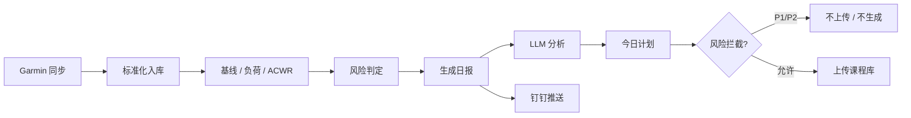

# 健康运动管理系统（Health System）

本地优先的个人健康运动管理系统：Garmin 数据同步 → 标准化与质量校验 → AI 教练分析 → 训练计划生成 → 风险拦截 → 周期报告与推送。

- **定位**：单用户、无登录、无多租户。设计选择明确，不为「做成平台」而引入认证或权限模型。
- **技术路线**：全 Python 后端（FastAPI + python-garminconnect）+ React 前端；单容器 Docker 部署于群晖 NAS。
- **核心价值**：把可穿戴数据变成可执行的训练决策，并用程序化风险引擎（非 LLM）做硬拦截。

> 本文档面向**最终用户**（日常使用、本地开发、NAS 部署）为主，**维护者/架构评审者**为辅。架构诊断与改进建议见 [`ARCHITECTURE_REVIEW.md`](./ARCHITECTURE_REVIEW.md)。

---

## 1. 项目简介

### 1.1 解决什么问题

个人训练者每天需要：

1. 从 Garmin 拉取睡眠、HRV、静息心率、Body Battery、活动与 FIT 明细；
2. 计算训练负荷与 ACWR，评估恢复状态；
3. 生成「今日能否练、练什么强度」的决策与计划；
4. 产出日/周/月报告，并通过钉钉推送；
5. 将计划上传到课程库（Tredict）但不自动排期。

本系统把上述流程自动化，并在**风险过高时硬拦截**计划生成与上传。

### 1.2 核心特性

| 特性        | 说明                                              |
| --------- | ----------------------------------------------- |
| Garmin 同步 | `python-garminconnect` 独立鉴权，原始数据 append-only 落盘 |
| FIT 解析    | 官方 Garmin FIT SDK 主解析 + fitdecode 交叉校验          |
| 负荷与 ACWR  | Banister TRIMP（有氧按圈分段）+ 力量负荷，混合方法               |
| 风险引擎      | 三态数据关卡（A/B/C）+ 四级优先级（P1–P4），规则注册表驱动，纯程序逻辑       |
| AI 教练     | DeepSeek（OpenAI 兼容）：日报分析用 chat，深度分析用 reasoner   |
| 计划生成      | 周计划 / 今日计划 / 12 周计划，受风险拦截约束                     |
| 周期报告      | 日报、周报、月报，前端 ECharts 可视化                         |
| 钉钉推送      | 群机器人 Webhook + 加签，含「查看完整报告」外链                   |
| 运维台       | 健康检查、任务状态、故障注入与恢复、审计日志                          |
| 单容器部署     | nginx + uvicorn + APScheduler，supervisord 托管    |

### 1.3 非目标

- 多用户 / 登录 / 权限系统
- 实时推送（WebSocket）
- 云端多租户 SaaS
- 自动排期到第三方课表（仅上传课程库）

---

## 2. 技术栈与运行环境要求

| 层        | 选型                                                        | 版本要求                      |
| -------- | --------------------------------------------------------- | ------------------------- |
| 语言       | Python                                                    | ≥ 3.12                    |
| 后端框架     | FastAPI + Uvicorn                                         | ≥ 0.115 / ≥ 0.32          |
| ORM / 迁移 | SQLModel + Alembic                                        | ≥ 0.0.22 / ≥ 1.14         |
| 数据       | SQLite（单文件）                                               | 系统自带                      |
| 调度       | APScheduler                                               | ≥ 3.10                    |
| Garmin   | python-garminconnect                                      | ≥ 0.3.17                  |
| FIT      | garmin-fit-sdk + fitdecode                                | ≥ 21.218 / ≥ 0.11         |
| LLM      | openai SDK（DeepSeek）                                      | ≥ 1.50                    |
| 前端       | React 18 + Vite 5 + TypeScript 5 + Tailwind 3 + ECharts 5 | 见 `frontend/package.json` |
| 部署       | Docker + docker-compose（单容器）                              | 群晖 DS220+ 验证过             |

**平台**：Linux / macOS / Windows（本地开发建议 Git Bash 或 WSL）；生产目标为群晖 DSM。

---

## 3. 安装

### 3.1 克隆与目录

```bash
git clone https://github.com/hs40/health-system.git
cd health-system
```

数据目录约定（**不要**把 `data/` 提交到版本库）：

```
data/
├─ raw/              # Garmin 原始 JSON / FIT（应用层保证 append-only）
├─ db/               # SQLite：health.db
├─ audit/            # JSONL 审计
└─ garmin_tokens/    # Garmin tokenstore
```

### 3.2 后端依赖

**推荐在项目外或项目内独立 venv，避免污染全局。**

```bash
cd backend
python3.12 -m venv .venv
# Linux/macOS
source .venv/bin/activate
# Windows
# .venv\Scripts\activate

pip install -U pip setuptools wheel
pip install -e ".[dev]"
```

### 3.3 前端依赖

```bash
cd frontend
npm install
```

### 3.4 环境变量

```bash
cp .env.example .env
# 编辑 .env，至少填写：
#   GARMIN_EMAIL / GARMIN_PASSWORD
#   LLM_API_KEY
#   （可选）TREDICT_TOKEN、DINGTALK_WEBHOOK、QWEATHER 相关
```

**重要**：`.env` 中**不要**在值后面写行尾注释（`KEY=value  # 说明`），dotenv 会把注释当作值的一部分。

### 3.5 数据库初始化

应用启动时会调用 `init_db()`（见 `backend/app/main.py` lifespan），基于 SQLModel metadata 建表。生产/升级路径使用 Alembic：

```bash
cd backend
# 查看当前迁移
alembic current
# 升级到最新
alembic upgrade head
```

迁移脚本位于 `backend/app/db/migrations/versions/`。

---

## 4. 配置说明

配置由 `backend/app/config.py` 的 `Settings`（pydantic-settings）统一加载，优先级：构造参数 > 环境变量 > `.env` > 默认值。

| 配置项                                        | 默认值                                   | 说明                         |
| ------------------------------------------ | ------------------------------------- | -------------------------- |
| `APP_ENV`                                  | `dev`                                 | 运行环境标识                     |
| `APP_HOST` / `APP_PORT`                    | `0.0.0.0` / `8000`                    | Uvicorn 监听                 |
| `LOG_LEVEL`                                | `INFO`                                | 日志级别                       |
| `RAW_DATA_DIR`                             | `/data/raw`                           | Garmin 原始数据目录              |
| `DB_PATH`                                  | `/data/db/health.db`                  | SQLite 路径                  |
| `AUDIT_DIR`                                | `/data/audit`                         | 审计 JSONL 目录                |
| `GARMIN_EMAIL` / `GARMIN_PASSWORD`         | 空                                     | Garmin 账号（SecretStr）       |
| `GARMIN_IS_CN`                             | `true`                                | 是否中国区                      |
| `GARMIN_TOKENSTORE`                        | `/data/garmin_tokens`                 | Token 持久化目录                |
| `TREDICT_TOKEN`                            | 空                                     | Tredict API Token          |
| `LLM_PROVIDER` / `LLM_BASE_URL`            | `deepseek` / DeepSeek API             | LLM 配置                     |
| `LLM_API_KEY`                              | 空                                     | 必填才启用 LLM                  |
| `LLM_MODEL_DAILY` / `LLM_MODEL_REASONING`  | `deepseek-chat` / `deepseek-reasoner` | 模型                         |
| `RISK_RULE_VERSION`                        | `0.2.0`                               | 风险规则版本（进入审计）               |
| `DINGTALK_WEBHOOK` / `DINGTALK_SECRET`     | 空                                     | 钉钉机器人（空=禁用）                |
| `APP_BASE_URL`                             | `http://hs.qingtianjian.com:18080`    | 报告外链前缀                     |
| `SCHED_TZ`                                 | `Asia/Shanghai`                       | 调度时区                       |
| `DAILY_JOB_CRON` 等                         | 见 `.env.example`                      | 日/周/月/睡眠重试/Tredict 同步 cron |
| `DUMBBELL_WEIGHTS_KG` / `DUMBBELL_IS_PAIR` | 见代码默认                                 | 力量器材档位                     |

密钥类字段使用 `SecretStr`，日志与 repr 自动脱敏。

---

## 5. 快速开始 / 使用说明

### 5.1 本地一键启动（推荐）

```bash
# 项目根目录
./scripts/dev.sh
# 或 Windows 双击
# dev.cmd
```

- 后端：`http://localhost:8000`（OpenAPI：`/docs`）
- 前端：`http://localhost:5173`（Vite 代理 `/api` → 后端）

仅后端或仅前端：

```bash
./scripts/dev.sh --backend-only
./scripts/dev.sh --frontend-only
```

### 5.2 手动启动

```bash
# 后端
cd backend
source .venv/bin/activate
uvicorn app.main:app --reload --host 0.0.0.0 --port 8000

# 前端（另一终端）
cd frontend
npm run dev
```

### 5.3 典型使用流程



1. **每日自动**（默认 07:30）：同步当天 → 补齐前一日活动与负荷 → 标准化 → 风险 → 日报 → LLM → 计划 → 钉钉。
2. **手动触发**：前端「运维台」或 API `/api/ops/...`。
3. **查看**：日报 / 周计划 / 周报 / 月报 / 数据趋势 / 训练负荷 / 运动训练详情。

### 5.4 常用 API（摘录）

| 方法   | 路径                          | 说明                 |
| ---- | --------------------------- | ------------------ |
| GET  | `/api/ops/health`           | 健康检查（DB、目录、依赖配置状态） |
| POST | `/api/ops/sync`             | 触发同步               |
| GET  | `/api/reports/daily/{date}` | 日报                 |
| GET  | `/api/plans/...`            | 计划相关               |
| GET  | `/api/activities/...`       | 活动列表与详情            |

完整契约见启动后的 `/docs` 或前端 `openapi-typescript` 生成结果。

### 5.5 NAS 生产部署（唯一现行方式）

镜像由 GitHub Actions 构建并推送到 **ghcr.io/hs40/health-system**。

构建前会先跑 `quality` job（ruff + 全量 pytest + 前端 `npm run build`），任一失败则不出镜像。

| 触发                | 镜像标签                     |
| ----------------- | ------------------------ |
| push `main`       | `:latest` + `:sha-<短哈希>` |
| push tag `vX.Y.Z` | `:vX.Y.Z` + `:latest`    |

**正式发版必须打 tag**：

```bash
git tag v3.1.0
git push origin main
git push origin v3.1.0
```

NAS 上（示例路径 `/volume1/docker/health-system`）：

```bash
sudo -i
cd /volume1/docker/health-system
HS_TAG=v3.1.0 bash nas_deploy_single.sh
```

- 访问：`http://<NAS-IP>:18080/`
- 健康检查：`curl -fsS http://127.0.0.1:18080/api/ops/health`
- 回滚：换 `HS_TAG` 再跑同一脚本（不动 `data/`）

#### 发版必做：同步宿主部署脚本 `nas_deploy_single.sh`

`nas_deploy_single.sh` 是 NAS 宿主 `/volume1/docker/health-system/` 下的**独立文件**：
`Dockerfile.single` 不 `COPY` 它、CI 不推送它、compose 也不挂载它。`HS_TAG` 只切换
镜像 tag，**不会更新这个脚本**。因此每次发版（至少在该脚本有变更时）都要先把仓库
`deploy/nas_deploy_single.sh` 同步到宿主同名路径，再跑部署命令；否则宿主仍执行旧
脚本，新版逻辑不会生效。

> 同步的是**部署脚本（代码）**，与「容器自足拉取健康数据」不冲突：应用侧已无需
> 人工搬运 `fit_jsonl/`（见下文），但脚本本身仍要随版本交付到宿主。

**真实教训（v3.4.5）**：该版在脚本里新增「5.1 部署后立即触发一次逐秒心率明细补齐」，
但发版只推了镜像、没同步宿主脚本 —— 宿主仍是旧版，5.1 不存在、当晚 23:30 又未到点，
补齐从未运行，导致 2026-10-26 之后跑步详情页两张 HR 图升级后仍未恢复；同步脚本并
手动触发一次 `fit_backfill` 后才恢复。

> 补注（v3.4.8）：上文的「5.1 立即触发」已移除（稳定态下退化为零请求的幂等空跑，
> 明细改由 23:30 调度 job + 上传时就地补 gz 保障）。但**「脚本不进镜像、发版必须
> 同步宿主」这条交付规则持续有效** —— 下面这段同步步骤仍然必做。

同步与校验（开发机 → NAS，端口 222，账户 `hs40`）：

```bash
# 1. 备份宿主旧版
ssh -p 222 hs40@192.168.2.2 \
  'cp /volume1/docker/health-system/nas_deploy_single.sh \
      /volume1/docker/health-system/nas_deploy_single.sh.bak'
# 2. 同步新版并去掉 CRLF（避免 Windows 换行导致 bash 执行异常）
tr -d '\r' < deploy/nas_deploy_single.sh | \
  ssh -p 222 hs40@192.168.2.2 \
  'cat > /volume1/docker/health-system/nas_deploy_single.sh'
# 3. 远端校验语法 + 双端比对 sha256（一致即说明同步完整，不依赖脚本内特定版本字样）
ssh -p 222 hs40@192.168.2.2 \
  'bash -n /volume1/docker/health-system/nas_deploy_single.sh && \
   sha256sum /volume1/docker/health-system/nas_deploy_single.sh'
sha256sum deploy/nas_deploy_single.sh
```

确认无误后再执行：
`cd /volume1/docker/health-system && sudo HS_TAG=v3.4.5 bash nas_deploy_single.sh`。

数据重灌与镜像发版分离，见 `scripts/pack_data.sh`。

**逐秒心率明细由容器自足补齐（v3.4.5 起，不再人工搬运）**：

运动训练详情「心率区间」「时间—心率」两图的唯一数据源是
`data/raw/garmin/fit_jsonl/<activityId>.jsonl.gz`。历史上它由本机
`backend/scripts/parse_fit.py` 生成后随 `data/` 人工搬到 NAS；但容器镜像只
`COPY backend/app`（不含 `scripts/`）、scheduler 无解析 job，本机 daily 自
2026-10-26 停跑后，NAS 每天新增的活动永远没有对应明细 —— 这是**持续性的
架构缺口**，不是「一次搬运没做」。

v3.4.5 起容器内 `app/services/fit_backfill.py` 自愈：

- 每天 `23:30`（`config.fit_backfill_cron`）扫描 `activities/*.json` 中缺
  `fit_jsonl/<aid>.jsonl.gz` 的活动，按现有 Garmin 凭据下载 `.fit` → 复用镜像内
  `app/parsers/fit.py` 解析 → append-only 写 `fit_jsonl/<aid>.jsonl.gz`；
  只补空、幂等、单条失败不阻断其余。
- v3.4.6 起 `tredict_sync` 上传前调 `ensure_fit_jsonl` **就地补**该活动明细，
  新上传活动当场即有逐组数据，不必等 23:30。
- 逐条失败写 `data/raw/garmin/_backfill_reports/<date>.json`，汇总进消息中心
  （同日去重）；钉钉只在「整批失败 / Garmin 登录失效 / 连续 3 天仍有缺口」时报。
- 已授权容器无人值守登录 Garmin 拉取个人健康数据（沿用现有凭据，不新增账号/密钥）；
  运维部署脚本仍只建目录、不搬运含个人健康信息的 raw。

`deploy/nas_deploy_single.sh` 启动前自检该目录，缺失时提示「容器将自动补齐」，
不阻断部署、不自动搬运。补齐后刷新详情页即可，两图 `hr_data_state` 由
`fit_missing` 变为 `ok`。

> ⚠️ **禁止将 18080 直接暴露到公网**
>
> 本系统是**单用户、无登录、无鉴权**设计（见 `AGENTS.md` §1），且 CORS 允许任意来源。
> 一旦端口暴露到公网，任何人都能读取你的全部健康数据，并能调用同步、计划上传、
> 故障恢复等写操作。只允许在内网/VPN 内访问；确需远程访问请在 NAS 前置反向代理并
> 自行加 Basic Auth 或 mTLS，且不要关闭代理的鉴权。


---

## 6. 常见问题与排错

| 现象             | 可能原因                    | 处理                                              |
| -------------- | ----------------------- | ----------------------------------------------- |
| Garmin 同步失败    | 账号/密码错误、Token 过期、网络/DNS | 检查 `.env`；健康检查看 `garmin` 项；群晖需显式 DNS（见 compose） |
| LLM 分析显示失败     | 未配置 `LLM_API_KEY`       | 配置后重启；健康检查 `llm` 项                              |
| 钉钉不推送          | `DINGTALK_WEBHOOK` 为空   | 留空即禁用；填入后生效                                     |
| 日报「前一日训练回顾」为空  | 前一日 activities 未同步      | 日任务会 best-effort 回补；也可手动触发同步                    |
| 容器内域名解析失败      | 群晖 Docker 内置 DNS 问题     | compose 已显式指定 `dns: 192.168.2.1` 与 `223.5.5.5`  |
| 端口被占用          | 本地 8000/5173 冲突         | `BACKEND_PORT` / `FRONTEND_PORT` 覆盖             |
| Alembic 与模型不一致 | 手工改表或漏跑迁移               | `alembic upgrade head`；必要时检查 `models.py` 与版本脚本  |

更多运维细节见前端「运维台」与审计日志（`data/audit/`）。

---

## 7. 验证方式

### 7.1 单元与集成测试

```bash
cd backend
source .venv/bin/activate
# 数据目录会被 conftest 重定向到临时目录，不会污染仓库
python -m pytest tests/ -q
```

**实际验证结果（2026-11-07，本地开发机，FIT 双库齐全）**：

- `python -m pytest tests/ -q` → **1104 passed**（无跳过、无失败）
- `ruff check app/ scripts/ tests/` → 全绿
- `npm run build` → 通过（类型检查 + 产物构建）

CI 的 `quality` job 覆盖 `ruff` + `pytest`（后端）；前端类型检查由 `deploy/Dockerfile.single`
stage 1 的 `npm run build` 覆盖。任一失败则不产出镜像。

`tests/test_architecture_layering.py` 把 `AGENTS.md` 的分层约定变成了可执行断言：
调度器不得函数内延迟导入、services 不得反向依赖 orchestrator、
`services/` 与 `domain/` 模块体量预算、日志配置单点化与 `hs.*` 命名规范。

### 7.1.1 生成 OpenAPI 类型

```bash
cd frontend
npm run gen:api      # 后端离线导出 → src/api/schema.d.ts
```

无需先启动后端：后端通过 `app.openapi()` 直接导出（不连数据库）。生成物
`schema.d.ts` 按 `.gitignore` 忽略——**策略是构建时生成、不入库**，需要时重建即可。
`src/api/types.ts` 目前仍为手工维护并与后端契约对齐；迁移到生成类型时，
CI 必须先跑 `gen:api` 再做类型检查，否则类型文件不存在。

### 7.1.2 按 request_id 追一个请求

每个请求都有 `X-Request-ID`，链路是 `浏览器 → Nginx → 后端`：

- 前端每个请求自动带；`ApiError.requestId` 里就是它（服务端回写优先）。
- Nginx 没收到时用内置 `$request_id` 生成，access log 里是 `rid=` 字段。
- 后端把它注入日志上下文，行内渲染为 `[req <id>]`；响应头也回写同一个值。

排障时拿一个 ID 即可对齐两处：

```bash
docker logs <container> 2>&1 | grep '<request-id>'    # Nginx 与后端日志同在该流中
```

后端 access log 只记 `status>=400` 或耗时 `>=500ms` 的请求——正常请求在 Nginx
日志里有全量记录，后端不重复记。

### 7.1.3 调整风险阈值（不改源码）

候选阈值可外置为数据文件，`data/rule_thresholds.json`（或 `RULE_THRESHOLDS_FILE` 指定）：

```json
{ "P1-LOAD-HRV": { "acwr_high": 1.45 } }
```

上线前先看影响面（只读，不写库）：

```bash
cd backend
python -m app.domain.calibration_cli --file ../data/rule_thresholds.json
```

只允许覆盖**已存在**的阈值键，类型必须与默认值一致；文件非法会直接报错而非静默忽略。
样例见 `backend/rule_thresholds.example.json`。文件不存在时使用代码默认值。

### 7.2 静态检查

```bash
cd backend
ruff check app/ scripts/ tests/
# 可选
mypy app/
```

### 7.3 前端构建

```bash
cd frontend
npm run build
```

### 7.4 健康检查确认安装成功

```bash
curl -fsS http://localhost:8000/api/ops/health | jq .
```

应返回各依赖 `ok` 状态（未配置的外部服务会明确标为 not configured，属正常）。

---

## 8. 项目结构

```
health-system/
├─ backend/                      # FastAPI 后端
│  ├─ app/
│  │  ├─ api/                    # REST 路由（薄层）
│  │  ├─ adapters/               # Garmin / Tredict / LLM / 天气 / 钉钉
│  │  ├─ domain/                 # 纯计算：负荷、风险、基线、处方、策略…
│  │  │  ├─ load/                # ACWR、TRIMP、运动类型
│  │  │  └─ strength/            # 力量动作库与注释
│  │  ├─ services/               # 应用服务与流水线
│  │  │  └─ reports/             # 日/周/月报生成
│  │  ├─ storage/                # SQLite / 审计 / 标准层仓储
│  │  ├─ orchestrator/           # 调度器、任务状态、补算 CLI
│  │  ├─ parsers/                # FIT 解析
│  │  ├─ schemas/                # Pydantic 契约
│  │  ├─ db/                     # models + Alembic
│  │  ├─ config.py
│  │  ├─ errors.py
│  │  └─ main.py                 # FastAPI 入口
│  ├─ tests/                     # 大量单元/集成测试
│  ├─ scripts/
│  ├─ pyproject.toml
│  ├─ alembic.ini
│  └─ Dockerfile
├─ frontend/                     # React + Vite + TS + Tailwind
│  └─ src/
│     ├─ pages/                  # 日报/周报/月报/计划/负荷/训练…
│     ├─ components/
│     ├─ api/
│     └─ design/
├─ deploy/                       # 单容器 Dockerfile、nginx、supervisord、NAS 脚本
├─ scripts/                      # dev.sh、pack_data.sh、各类 probe
├─ docker-compose.single.yml
├─ .env.example
├─ AGENTS.md                     # 给协作者与 AI 代理的约定
├─ README.md                     # 本文档
└─ ARCHITECTURE_REVIEW.md        # 架构诊断与改进建议
```

**分层原则**（见 `AGENTS.md`）：

- `api/`：只做参数校验与编排，不写业务逻辑。
- `domain/`：纯函数、无 IO。
- `services/`：编排 domain + storage + adapters。
- `adapters/`：外部系统边界。
- `storage/`：持久化细节。

---

## 9. 维护者视角

### 9.1 模块地图（简）

- **入口**：`backend/app/main.py` → 各 `api/*` 路由。
- **日闭环**：`orchestrator/scheduler.py` → `services/daily_pipeline.py` → `report_service` / `coach_service` / `plan_service` / `dingtalk_service`。
- **风险核心**：`domain/risk.py` → `domain/priority.py` + `domain/rule_registry.py`（规则表驱动）。
- **负荷核心**：`domain/load/`（`compute_day`、ACWR、按运动类型的 TRIMP/力量公式）。
- **数据边界**：原始数据**不入库**，仅标准化与派生数据进 SQLite；原始以文件形式挂载。

### 9.2 关键约定

- 单用户、本地优先；CORS 在本地可放宽，生产由 Nginx 同源代理。
- 风险判定**禁止**被 LLM 覆盖（REQ-RISK-002）。
- P1 不生成计划、P2 不允许上传（REQ-RISK-003）。
- 规则与算法版本进入审计与报告，支持复盘。

### 9.3 已知技术债与指向

详见 **[ARCHITECTURE\_REVIEW.md](./ARCHITECTURE_REVIEW.md)**，摘要（截至 2026-11-08）：

已解决（v3.1.0）：

1. ~~健康检查混入 Windows/F: 盘硬编码路径~~ → 判定只用 `Settings`（A.2.1）。
2. ~~CI 只构建不测试~~ → 新增 `quality` job 前置门禁（A.9.1）。
3. ~~日流水线吞异常只留步骤字符串~~ → 失败结构化写入 Fault 表，运维台可查（A.4.2）。

已解决（v3.2.0）：

4. ~~调度器多处函数内延迟导入~~ → 15 条全部提到模块顶层（实测无循环依赖），并由 AST 测试锁定（A.2.2）。
5. ~~services 反向依赖 orchestrator（`task_state`）~~ → 下移至 `app/storage/task_state.py`，层级倒置消除（A.1.1 / A.2.2）。
6. ~~`daily_report.py` 725 行~~ → 抽出 `reports/daily_load.py`，降至 632 行（A.1.2）。
7. ~~`plan_service.py` 733 行~~ → 抽出 `plan_upload.py` / `plan12w_service.py` / `plan_context.py`，降至约 430 行（A.1.2）。
8. ~~分层与体量约定只写在文档里、无人执行~~ → `tests/test_architecture_layering.py` 以 AST 断言固化（A.1.1 / A.2.2）。

已解决（v3.3.0）：

9. ~~`domain/verify.py` 1016 行单文件~~ → 拆为 `verify/` 包 9 模块（最大 298 行），
   `__init__.py` 门面 re-export 46 个公开符号，调用方零改动（A.1.2）。
10. ~~日志配置散落两处、`Settings.log_level` 无人读、日志 0 条带任务标识~~ →
    `app/logging_conf.py` 单点配置 + `log_context` 上下文注入 + `hs.*` 命名规范（A.8.1）。
11. ~~阈值烧死在模块常量里，无法「换一套阈值重跑」~~ → `judge_priority(specs=...)` +
    `domain/calibration.py` 双规则集对照回放，只读 CLI（A.5.2 首版）。

已解决（v3.3.1，第二批 · 前端）：

12. ~~`DailyPage.tsx` 729 行~~ → 展示区块外提到 `components/reports/daily/`，
    结论规则入 `lib/headline.ts`，降至 440 行，最大子模块 110 行（A.1.2 前端）。
13. ~~`gen:api` 必须先起后端、失败无提示~~ → 后端离线导出 OpenAPI，`npm run gen:api` 一次跑通（A.9）。
14. ~~`src.bak-20261022` / 27 个 `vite.config.ts.timestamp-*` 残留~~ → 已清理（均未入库）。

已解决（v3.3.2，第二批 · 前端，续）：

15. ~~`WeeklyPlanPage.tsx` 757 行~~ → 展示区块外提到 `components/plan/weekly/`，
    降至 413 行，最大子模块 141 行；文案双向 diff 确认无用户可见变化（A.1.2 前端）。

已解决（v3.4.0，可观测性与配置收尾）：

16. ~~日志未贯穿采集端，Nginx / 前端 / 后端三者无法按请求关联~~ →
    `X-Request-ID` 全链路：Nginx 生成或透传、后端中间件注入日志上下文并回写响应头、
    前端 `ApiError.requestId` 可直接上报（A.8.1 剩余）。
17. ~~校准结果无法固化，候选阈值只能改源码~~ → `data/rule_thresholds.json`
    覆盖生效，非法文件直接报错而非静默忽略；CLI `--file` 与运行时同一套校验（A.5.2 剩余）。

已解决（v3.4.1，部署回归）：

18. ~~nginx `log_format` 写进 `server {}`，容器起不来~~ → 拆分 `nginx.http.single.conf`
    让 `map` / `log_format` 留在 `http` 上下文；构建期 `nginx -t` 把关（只看 `[emerg]`/`[error]`）。

已解决（v3.4.2，类型契约）：

19. ~~`types.ts` 手工维护 40+ interface，与后端契约漂移~~ → 改为
    `components['schemas']['X']` 派生，465 → 124 行。比对发现 5 处漏字段、3 处字段名错误；
    后端同时补齐 5 个裸 `dict` 契约（`LoadSeriesResponse` / `Plan12WeekItem` / `WeekPlanCard` 等）。
    CI 顺序固定为 `gen:api → tsc`，`schema.d.ts` 以 artifact 传给镜像构建（A.9 剩余）。
20. ~~`WeeklyPlan.evaluation` 是 `dict`，落库时把 pydantic 对象塞进 JSON 列~~ →
    改为 `PlanEvaluation | None`，由 `_plan_payload` 显式 `model_dump`。
21. ~~CI 前端构建在 Linux runner 上失败，Windows 本地却通过~~ →
    `package-lock.json` 在 Windows 生成，lock 里没有 `@rollup/rollup-linux-x64-gnu` /
    `@esbuild/linux-x64` 条目，`npm ci` 永远不会装它们。CI 改为 `npm ci` 后补装
    这两个包（版本与 lock 逐字一致，由测试把关）；前端构建整体前移到 quality job，
    Dockerfile 只剩 `COPY frontend/dist`，不再碰 npm。
22. ~~`frontend/nginx.conf` / `Dockerfile` / `.dockerignore` 是旧三容器时代的前端独立镜像资产~~ →
    三者一并删除。唯一引用 `nginx.conf` 的是同目录下那个 `Dockerfile` 的
    `COPY nginx.conf`，compose 里早已没有 frontend 服务；现行单容器用
    `deploy/Dockerfile.single` + `deploy/nginx.single.conf`，nginx 由 supervisord 托管。
    这三个文件**不参与镜像构建**，删除对产物零影响，故未单独发版。
    回归测试：`test_deploy_config.py::TestNoLegacyFrontendImage`。

已解决（v3.4.3，构建链根治与死资产清理）：

23. ~~`package-lock.json` 的 `packages` 里没有任何平台原生包条目~~ →
    重新生成。旧 lock 的 `optionalDependencies` **声明**里全平台都有
    （esbuild 23 个 / rollup 27 个），但 `packages` 里连 win32 的条目都没有
    ——不是「Windows 只记录当前平台」，是压根没解析任何 optional 依赖。
    `npm ci` 因此装不到原生二进制，`vite build` 报 `Cannot find module`。
    修法：删掉旧 lock，用 `npm install --package-lock-only` **全新解析**
    （只解析元数据、不安装，**不需要 Linux 环境**），得到 49 个带
    `os` / `cpu` / `optional` 的全平台条目。CI 恢复纯 `npm ci`，
    两行 `npm install --no-save` 补装与版本锁定测试一并删除。
    代价：全新解析顺带把 27 个包升到 `^` 范围内最新版（rollup
    4.64.6 → 4.68.0、react-query 5.104.2 → 5.107.1、@babel/* 等），
    已用本地 `npm ci` + `tsc` + `vite build` 与 CI 双重验证。
    回归测试：`TestLockPlatformCoverage`（锁「lock 自足」而非「CI 会补」）。
24. ~~`backend/Dockerfile`（路线 C 旧后端独立镜像）与 4 个
    `vite.config.ts.timestamp-*.mjs` 残留~~ → 前者 `git rm`，后者清理。
    `.gitignore` 第 47 行**早已有** `*.timestamp-*.mjs` 规则，这些文件从未入库；
    但 vite 把 `vite.config.ts` 编译成临时 `.mjs` 后的清理被 safe-delete hook
    拦住，每次 build 都会再生——属本机现象，仓库层只保证「git 索引里没有」。

已解决（v3.4.4，可观测性：两图空白不再无从判断）：

25. ~~缺 `fit_jsonl` 时静默返回 `{}`，两图只显示「本次无逐秒心率数据」~~ →
    `load_fit_messages` 改为返回 `FitMessages(by_type, source)`，缺文件显式
    `source="missing"`；`activity_detail` 给出 `hr_data_state` 三态
    （`ok` / `no_hr_samples` / `fit_missing`），前端把「FIT 明细未同步」与
    「本次确实无逐秒心率」分开显示。两图共用同一 `record` 数据源，
    以前一起空白时无从判断是数据没同步还是软件故障。
26. ~~训练详情契约是裸 `dict`，`training.ts` 手抄 173 行 interface~~ →
    `/api/activities/detail` 与 `/calendar` 补 Pydantic `response_model`，
    `frontend/src/api/training.ts` 改为从 `schema.d.ts` 派生（A.9 收尾）。
    契约收紧后派生类型的 optional 字段由组件 `?? []` 兜底，`tsc` 把关。
27. ~~NAS 部署脚本只建目录、不提示数据没搬全~~ →
    `deploy/nas_deploy_single.sh` 启动前自检 `data/raw/garmin/fit_jsonl/`，
    为空/缺失打印可操作告警；只检查、不自动搬运健康数据。
    回归测试：`TestFitJsonlPreflight`（自检在启动前、告警点明影响、不出现搬运指令）。
    （v3.4.5 起容器自动补齐，见下。）

已解决（v3.4.5，逐秒心率明细持续缺失 —— 架构缺口根治）：

28. ~~`fit_jsonl` 只由本机 `scripts/` 生成后人工搬到 NAS，容器不解析~~ →
    根因不是「某次搬运没做」：容器镜像只 `COPY backend/app`（不含 `scripts/`）、
    scheduler 六个 job 无解析任务，本机 daily 自 2026-10-26 停跑后，NAS 每天
    新增活动必然 `fit_missing`。新增 `app/services/fit_backfill.py` 让容器自足：
    发现缺失 → 按现有 Garmin 凭据下载 `.fit` → 复用镜像内 `app/parsers/fit.py`
    解析 → append-only 写 `fit_jsonl/<aid>.jsonl.gz`（只补空、幂等、失败隔离）。
29. ~~补齐只能等人工搬运或本机 daily~~ →
    `config.fit_backfill_cron`（每日 23:30）注册独立 `fit_backfill` job；
    v3.4.6 起上传前再由 `ensure_fit_jsonl` 就地补一次。（v3.4.5 曾在部署脚本里
    「5.1 立即触发」，v3.4.8 移除：稳定态下该步只是 `skipped=316 / filled=[]`
    的零请求幂等空跑。）回归测试：`test_fit_backfill.py` /
    `test_fit_backfill_job.py` / `test_fit_backfill_deploy.py` 覆盖解析存储、
    只补空幂等、失败隔离、cron 注册，以及脚本不再要求人工搬运 / 不再触发 5.1。
30. ~~失败无留痕、告警会刷屏~~ →
    逐条失败写 `data/raw/garmin/_backfill_reports/<date>.json`，汇总进消息中心
    （同日 `ref_id` 去重）；钉钉只在「整批失败 / Garmin 登录失效 / 连续 3 天仍有缺口」
    时报。`test_fit_backfill_alerts.py` 覆盖三种严重情形、静默情形，以及补齐后
    `/api/activities/detail` 由 `fit_missing` → `ok` 的端到端回归。

已解决（v3.4.6，力量明细「总次数冒充每组次数」回归 —— 三层修复）：

31. ~~10-26 起力量 notes 把「3 组共 60 次」显示成「60次 × 3组」~~ →
    与 v3.4.5 HR 两图**同根**：本机 daily 停跑 → 新活动缺 `fit_jsonl` →
    `notes.py` 无 FIT 兜底把 `summarizedExerciseSets[].reps`（**N 组总次数**）
    塞进「每组次数」位置。FIT 逐组 `set` 消息才是唯一正确来源；`23/3`、`70/6`
    不整除，绝不能用 `reps/sets` 伪造每组值。
32. ~~补 `fit_jsonl` 后云端错误 notes 不自愈~~ →
    notes 在 23:00 上传时一次性固化，且「只补空、绝不覆盖已有 notes」是契约。
    **A 层**：`tredict_sync_service._build_notes` 生成前调
    `fit_backfill.ensure_fit_jsonl`，就地复用已落盘的 `.fit` 解析写 gz
    （零额外 Garmin 请求），上传与补空两条路径都生效；**C 层**：无 FIT 时改用
    不误导的总量表述「共60次（3组，缺逐组明细）」，绝不输出伪造每组值。
33. ~~历史错误 notes 无回填手段~~ →
    离线工具 `backend/scripts/strength_notes_backfill.py`：按三重判据（日期 ≥ 10-26
    + 以「力量明细：」开头 + 与 FIT 重算的 want 有差异，且必须有 FIT 逐组明细）
    产出受控清单，人工逐条确认后**仅对显式 `tredict_id` 白名单**调
    `update_activity` 覆盖；不改「只补空」常驻契约、不动手写 / 旧 Node /
    已正确 / 空 notes 记录。

口径登记：`summarizedExerciseSets[].reps` = 总次数、`sets` = 组数，见
`docs/派生指标口径登记表.md` §A-2 字段语义澄清；Q3 自重负荷高估
（`exercises.py:181` 的 `sets × reps`）登记为独立遗留项 **S-1**，见
`docs/待验证事项.md`，本次不纳入。

已解决（v3.4.7，日报因恢复日模板 `hr_zone` 脏值静默缺失 —— 三层修复）：

34. ~~11-09 日报全天未生成、六次调度全部静默失败~~ →
    P1 恢复日模板把 `RECOVERY_TEMPLATE_ZONE`（`"Z1"`）误写进 `main[].hr_zone`
    （该字段契约是数字 1–5，`target_hr_zone` 才是 `Z1`）；11-08 的恢复日计划
    在 11-09 首次进入 `goal_progress` 的 7+7 天窗口 → `int("Z1")` 抛
    `ValueError` → `generate_daily` 抛穿 → 当天日报缺失、无 Fault、无 audit。
35. ~~上下游都不认这个格式~~ →
    **A 上游**：`coach_service._recovery_session` 改用 `zone_int(...)` 写数字 1，
    不再产生脏数据；**B 下游**：`goal_progress._zone_number` 兼容 `1` / `"2"` /
    `"Z2"` / `"z2"`，越界与脏值跳过（同时修好 DB 里**已存在**的历史脏数据）。
36. ~~日报生成是下游唯一没有兜底的步骤~~ →
    **C 调度**：`scheduler._run_downstream` 给 `generate_report` 加 try/except +
    `_record_step_fault("report@<date>")`，失败不抛穿、后续步骤照跑、运维台可见；
    与其余四步（analysis / plan / dingtalk / upload）口径一致。

诊断方法（可复用）：把 NAS DB 做 `sqlite3 .backup` 一致性快照 + activities 拉回本机
副本，用本机 `.venv` 直接调 `generate_report(date)` 复现 traceback，全程不动生产。
部署 v3.4.7 后需在容器内手动触发一次日任务补生成当日日报（07:30 已过不会自动重跑）。

尚存：

1. 代码里仍保留「阈值均为候选值」的依据说明（`rule_registry` 的 `Basis.INFERRED`），
   这是**依据等级**标注而非待办——阈值现在可通过数据文件校准，但「校准到多少」需真实数据支撑。

### 9.4 给 AI 编码代理

请先阅读根目录 **`AGENTS.md`**，再动手改代码。其中明确了分层、禁止事项与测试入口。

---

## 许可证与隐私

本仓库为个人项目源码。`docs/` 与需求报告中可能含个人健康数据与内网拓扑，**不纳入版本库**。使用时请自行妥善保管 `.env`、`data/` 与 secrets。
